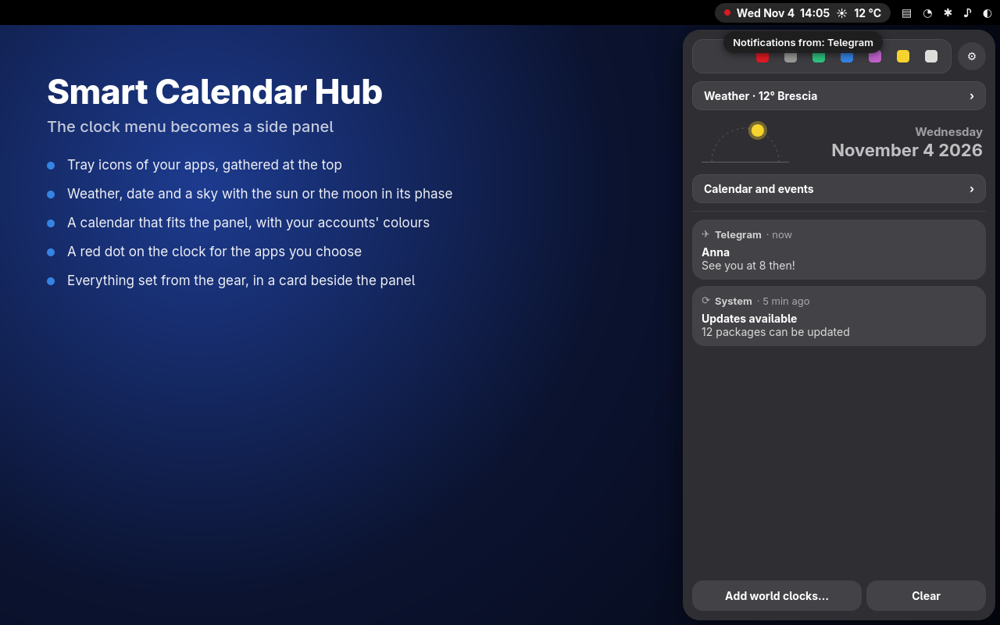
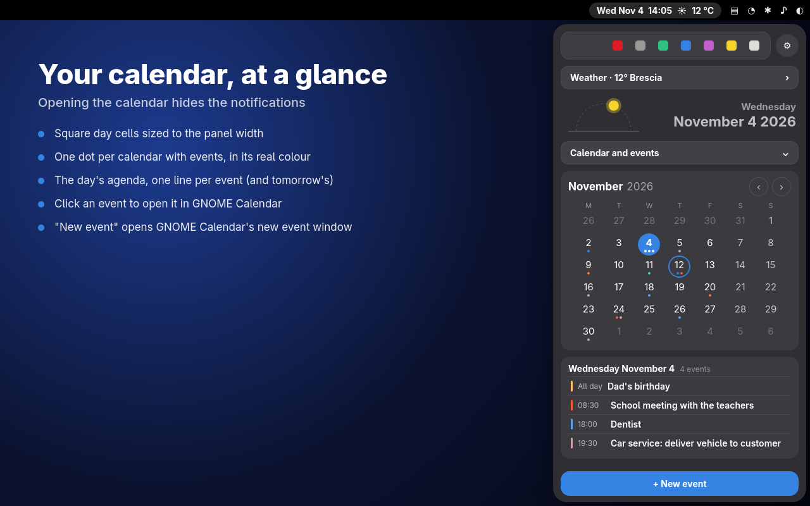
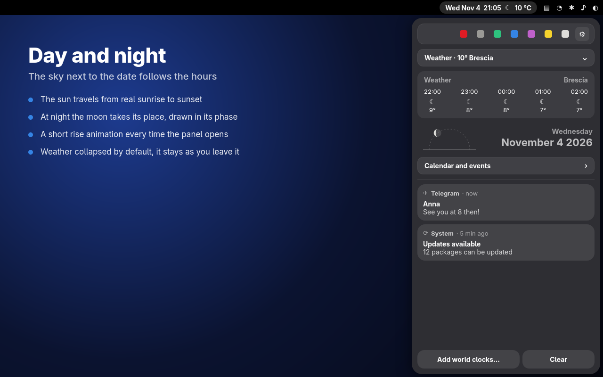
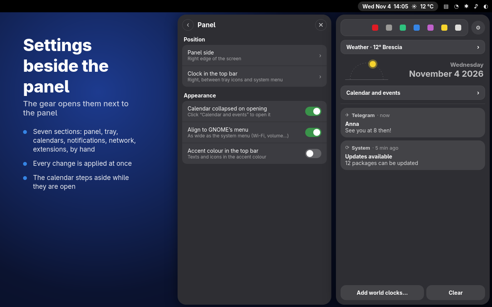

# Smart Calendar Hub

A GNOME Shell extension that turns the clock menu into a side panel.

**Website: https://bria-bria.github.io/smart-calendar-hub/**

From top to bottom the panel shows:

1. tray icons of applications (optional), with the button that opens the
   settings on their right,
2. weather, collapsed at login (it stays as you leave it until you log out),
3. today's date,
4. the calendar and events, collapsed by default,
5. GNOME's "Today" card with the events of the day (it can be switched off);
   a click opens the calendar in a card of its own next to the panel,
6. notifications,
7. world clocks as analogue clocks, in a card of their own always at the
   bottom (hover one for the city and time, arrows when they do not fit),
8. the bottom row: GNOME Clocks, New event, Clear.

It also shows the weather inside the clock pill (icon and temperature, before
or after the clock, with the description for a few seconds after each update;
unless another extension, such as Weather O'Clock, already does it) and lets
you move the clock to a different spot of the top bar.

## Why Smart Calendar Hub

Smart Calendar Hub didn’t happen overnight. It grew out of two decades of
daily use: Michele has been working with Linux and GNOME since 2005, and
firmly regards GNOME as the cleanest, most reliable, and well-architected
desktop on Linux.

The vision was to take that design philosophy one step further. Most
extension developers naturally concentrate on the Quick Settings menu or add
standalone icons to the top panel. Yet the central panel — the Calendar &
Notification menu — has always been a prime, focused canvas with immense
untapped potential.

Smart Calendar Hub turns this central space into an organized productivity hub:

- **Clean and clutter-free**: everything you need in one predictable, unified location.
- **Thoughtful integration**: designed to respect GNOME’s native aesthetic while unlocking faster day-to-day workflows.
- **Friendly to the ecosystem**: a structured foundation not just for daily users, but an elegant host for future extension integrations.

It’s not about changing GNOME — it’s about giving its most central panel the
purpose and dynamism it deserves.

## Every extension in one place

A click on an icon of the tray opens its menu **inside the panel**, in place
of the cards, instead of a floating menu: the panel keeps its size, the menu
takes the same measure as the rest (items, separators, section titles) and
the backgrounds of its containers become transparent. Back with the arrow,
Esc or another click on the icon. It can be switched off, for all icons or
icon by icon (Settings → Tray).

The other extensions need no change: Smart Calendar Hub takes their menu as
it is, and never modifies their code.

### Extensions we recommend

We like these extensions and recommend them alongside Smart Calendar Hub. We
tested each one inside the panel and tuned the hub until it looked right
there — always on our side: their code stays exactly as their authors wrote it.

| Extension | How the hub works with it |
|---|---|
| [WiFi Signal Plus](https://extensions.gnome.org/extension/9329/wifi-signal-plus/) | details of the Wi-Fi connection, signal graph, nearby networks |
| [AppIndicator and KStatusNotifierItem Support](https://extensions.gnome.org/extension/615/appindicator-support/) | the tray icons of your apps and their menus, e.g. KTailctl (Tailscale) and Cachy-Update |
| [Top Bar Organizer](https://extensions.gnome.org/extension/4356/top-bar-organizer/) | with one switch, the clock position is written into its order so the two never fight (the old order comes back when switched off); the tray keeps its icons when it re-sorts them |
| [Vesperal](https://extensions.gnome.org/extension/11329/vesperal/) | tells time by the Sun: a click on the hub's sun and moon opens its menu inside the panel, all its settings open in the card beside the panel (from version 4 also the top bar content, the day from dawn to dusk and the notifications; with an offline city search and the year at a glance: day length through the year, solstices and equinoxes), and its own icon next to the clock can be hidden |
| [Battery Indicator Icon](https://extensions.gnome.org/extension/5718/battery-indicator-icon/) | by Deminder, where the idea of our battery circle comes from ([project](https://github.com/Deminder/battery-indicator-icon)): while it is on, the hub's own circle steps aside and lets it draw the battery, also on the lock screen |
| [Freon](https://extensions.gnome.org/extension/841/freon/) | temperatures of the processor, disks and graphics card, and fan speeds: its menu opens in the panel, its "Sensor Settings" item opens all its settings (what the menu and the top bar show, grouping, unit, polling interval, sensor sources) in the card beside the panel, the mouse wheel scrolls its long sensor lists, and an optional switch shows one thermometer in the tray instead of a reading per sensor |

### Built for the hub

[BlueHub](https://github.com/bria-bria/bluehub),
our other extension, manages several Bluetooth devices at once and lives
entirely inside the panel when Smart Calendar Hub is installed: its controls
in the column, its device lists in the card beside it, built with the page
kit. Without the hub it opens its own settings window.

## Screenshots






## Requirements

GNOME Shell 48, 49, 50 or 51. The weather comes from GNOME Weather: set a
location there to see the temperature.

Tray icons of applications are created by the
[AppIndicator and KStatusNotifierItem Support](https://extensions.gnome.org/extension/615/appindicator-support/)
extension: keep it enabled. Smart Calendar Hub only moves those icons inside
the panel; the preferences window shows a warning when that extension is off.

## Settings

Open the preferences (Extensions app → Smart Calendar Hub) or click the gear
icon next to the tray icons. They are in seven tabs:

- **Panel**: panel side (right, left, under the clock), clock position in the
  top bar, the date
  (it can be switched off, with the sun and the moon), the sky next to the date (sun and moon of the day, moon phase: each can be switched
  on alone), calendar collapsed on opening, panel width (or "Align to GNOME's
  menu": as wide as the system menu, automatically), space between the
  top bar icons (12 = GNOME default, less brings them closer), texts and
  icons of the top bar in GNOME's accent colour, the battery as a circle that
  empties with the charge (percentage inside optional) — the idea of
  [battery-indicator-icon](https://github.com/Deminder/battery-indicator-icon) by Deminder: while that extension
  is on, the hub leaves the battery to it and these two switches give way to
  a row that says so.
- **Tray**: which top bar icons move inside the panel, and a switch for each
  app. The menu of a tray icon (e.g. Cachy-Update) opens inside the
  panel, in place of the cards, instead of floating; it can be switched off,
  for all icons or icon by icon.
- **Calendars**: which calendars are shown. This is the same switch GNOME
  Calendar uses, so a calendar turned off here is off there too (your online
  accounts are not changed). Calendars shared between two accounts appear once.
- **Notifications**: apps silenced with the bell of a notification (1 hour,
  8 hours, until tomorrow morning, always: no pop-up and no red dot, the
  notifications stay in the panel; press another duration to change it, the
  coloured one again or "Unmute" to undo) and the apps that
  light the red dot on the clock — for notifications, or when their tray icon
  changes from the usual one (e.g. an unread badge).
- **Network**: IP addresses in the top bar (left, center or right): local
  network, VPN and public address. Each one switched on is listed in the menu
  that opens when you click the addresses; open its row to choose whether it
  is shown in the bar too. **IP address in Smart Calendar Hub** adds a box
  under the tray icons with the chosen addresses (local network, every active
  VPN, public), shaped like the weather row, one at a time with arrows;
  click one to copy it.
- **Extensions**: settings for the other extensions the hub works with, used
  only when they are installed. Top Bar Organizer sync (off by default; turn
  it on if you use Top Bar Organizer, otherwise both extensions try to place
  the clock). Vesperal: a click on the sun and moon opens its menu inside the
  panel (its "Preferences" and "Set a location manually…" items open all
  its settings in the card beside the panel), and its own icon next to the clock can be hidden. Freon: one
  thermometer icon instead of an icon and a temperature for each sensor.
  Battery Indicator Icon: whether it is on, with a button to turn it on if it
  is installed, or to get it from extensions.gnome.org.
- **By hand**: everything to be done outside the extension, with the
  commands to copy — the apps and extensions it uses, the extensions to switch
  off because they do the same things, calendar reminders that never show up,
  and the login screen script.

### Privacy and network use

Smart Calendar Hub asks for the public IP only if you switch on
**Public address** (off by default): it asks
`https://api.ipify.org` for your public IP address when the network changes
and every 30 minutes. That service sees the request.

When GNOME Weather has more than one city and you scroll to another city in
the panel, its weather is downloaded with GWeather from the same services
GNOME uses for the first city (MET Norway, airport METAR stations), at most
every 15 minutes while it is shown. Nothing else is sent
anywhere; calendars, notifications and settings stay on your computer.

## Lock screen and login screen

The look of the top bar (accent colour, space between the icons, clock
position) stays the same on the lock screen. Nothing else of the extension runs there: the side
panel, notifications, calendar and tray are taken down while the screen is
locked and built again when you unlock.

For the login screen (GDM), which belongs to the system, run once, and again
after changing those settings:

```bash
sudo ./installa-schermata-accesso.sh
```

It installs the extension for all users and copies your accent colour,
tone, icon spacing and clock position to the login screen.
`sudo ./installa-schermata-accesso.sh --rimuovi` takes it away.

## Install

Smart Calendar Hub is distributed here on GitHub. Choose one of two ways.

### Guided installer (easiest)

1. Download `install.sh` from the [latest release](https://github.com/bria-bria/smart-calendar-hub/releases/latest).
   You can open it with a text editor and read what it does first.
2. Run it:
   ```bash
   bash install.sh
   ```

It checks your GNOME version, downloads the latest version of the extension
(or uses the zip if you put it next to `install.sh`), checks the file,
installs it and turns it on. It can also give the login screen the same
top bar look: it asks first, and only that step needs your password.
Run it again to update; `bash install.sh --uninstall` removes it.

### By hand

1. Download `smart-calendar-hub@bria-bria.github.io.shell-extension.zip`
   from the [latest release](https://github.com/bria-bria/smart-calendar-hub/releases/latest).
2. Install it:
   ```bash
   gnome-extensions install --force smart-calendar-hub@bria-bria.github.io.shell-extension.zip
   ```
3. Log out and back in, then switch it on in the Extensions app
   (or run `gnome-extensions enable smart-calendar-hub@bria-bria.github.io`).

### From source

```bash
./installa-smart-calendar-hub.sh
```

The script builds `dist/smart-calendar-hub@bria-bria.github.io.shell-extension.zip`,
installs it and enables it. On Wayland, log out and back in to load it.

## Translations

Smart Calendar Hub is written in **English** and includes **Italian**.
Any other language can be translated by you, without programming:

1. Open the Smart Calendar Hub settings once (Extensions app → Smart Calendar
   Hub, or the gear icon in the panel). The extension creates the file
   `~/.config/smart-calendar-hub/translations/<language>.json`
   for your system language (for example `fr.json`, `de.json`, `es.json`).
   The file lives outside the extension folder, so updates never remove it.
2. Open the file with a text editor. Each line is
   `"English sentence": "your translation"`. Write your translation between the
   second pair of quotes:

   ```json
   "Weather": "Météo",
   "Settings": "Paramètres",
   "Calendar and events": ""
   ```

   - Sentences left empty (`""`) are shown in English.
   - Keep the words in braces, such as `{app}` or `{temp}`, exactly as they are:
     Smart Calendar Hub replaces them with real values.
3. Save the file and open the settings again. The side panel picks up the new
   texts at the next login.

**Updates never delete your work.** When a new Smart Calendar Hub version adds
new sentences, they are appended at the end of your file with an empty
translation; everything you have already translated stays as it is.

If the file contains a mistake (for example a missing comma), Smart Calendar Hub
does not touch it, shows English and writes the error in the system log
(`journalctl --user -f`).

**Please share your translation**: open an
[issue](https://github.com/bria-bria/smart-calendar-hub/issues) and attach your
file, so it can be included for everyone in the next version.

For developers: every sentence is passed in English to `_()` in
`extension/sch-i18n.js`, with values as placeholders
(`_('{app} (tray icon)', {app: name})`), and must have its Italian translation
in the `IT` table of the same file. `strumenti/controlla-traduzioni.py` checks
this (the install script runs it).

## For extension developers

An extension with a top bar icon (`PanelMenu.Button`) already shows its menu
inside Smart Calendar Hub. It can also tell the hub how to show it, with an
optional property on its button — read only by the hub, so the extension
keeps working the same without it:

```js
this._button.smartCalendarHub = {
    // title above the menu (default: the name of the icon)
    title: 'My extension',
    // optional: a page of your own instead of the menu, built at every
    // visit and destroyed after it (free timers and signals on 'destroy')
    buildPage: () => new St.Label({text: 'Hello'}),
    // optional: true = the hub leaves your backgrounds alone
    keepStyle: false,
};
```

- The normal menu is still needed, with at least one item: it is what users
  without the hub see, and what the hub shows when there is no page.
- Inside the hub your menu box (or your page) carries the style class
  `sch-hub-page`, for styles that apply only there.
- A complete example is in [examples/hello-hub@bria-bria.github.io](examples/hello-hub@bria-bria.github.io).

### Open a page without a tray icon

An extension with no top bar icon (for example one that lives in the Quick
Settings menu) can open a page of its own in the hub's panel:

```js
const hub = Main.extensionManager.lookup('smart-calendar-hub@bria-bria.github.io');
const shown = hub?.stateObj?.showExternalPage?.({
    id: 'my-extension',          // the same id while open: nothing changes
    title: 'My extension',       // title above the page
    buildPage: () => new St.Label({text: 'Hello'}),
    keepStyle: false,            // true: the hub leaves your backgrounds alone
    // optional: a second page in a card beside the panel (where the
    // calendar opens), for long lists; it scrolls by itself
    buildSidePage: () => new St.Label({text: 'More room here'}),
}) ?? false;
if (!shown)
    this.openPreferences();      // your own fallback
```

- The panel opens on your page, in the same card as the tray menus: back
  arrow, Esc, or closing the panel end the visit, and the page is destroyed
  then (free timers and signals on its `destroy`).
- It returns `false` when the hub is not installed, switched off, on the lock
  screen, or when `buildPage` throws or returns an actor that already has a
  parent: keep a fallback of your own.
- Nothing to register: one call, the hub owns the page while it is shown.
- `buildSidePage` is optional: if it throws or returns an invalid actor the
  main page is shown alone. The calendar beside the panel steps aside for the
  visit and comes back after it. Both pages are destroyed together.
- `hub.stateObj.externalPageFeatures` (read only) lists what this version
  supports beyond the main page: `['side']` means `buildSidePage`.

### Page model

Pages shown in the hub follow one model, so every extension looks like part
of the panel:

1. **The header is the hub's**: back arrow and title. Never draw your own.
2. **Section titles** small and grey, above groups of rows.
3. **Rows**, all alike, inside rounded cards: icon, title, one line of detail,
   and on the right one thing only — a switch, a value or a chevron.
4. **Pill buttons**, and **one** primary (accent colour) button per page.
5. **The card beside the panel** is the calendar's card: same width, height
   and alignment, which you cannot change. Use it only for long lists or
   details. Its header is drawn by the hub like the calendar's month header:
   `sideTitle`, an optional `sideCount`, at most two round `sideActions`
   (`{icon, label, onClick}`).
6. **Scrolling is the hub's**, in the column and in the side card.
7. **Empty state**: an icon and one sentence.

Only theme colours and GNOME's accent colour, no backgrounds of your own, no
windows or menus popping out of the panel.

The **page kit** gives you these pieces ready made, with the look of the
panel; if the look changes, your page follows:

```js
const hubState = Main.extensionManager.lookup('smart-calendar-hub@bria-bria.github.io')?.stateObj;
const kit = hubState?.pageKit;   // check hubState.externalPageFeatures includes 'kit'

const page = kit.page(
    kit.section('Shared audio'),
    kit.card(
        kit.row({icon: 'audio-headphones-symbolic', title: 'Headphones', subtitle: 'Connected · 80%',
            trailing: kit.toggle({active: true, onToggle: on => console.log(on)})}),
        kit.row({icon: 'input-gaming-symbolic', title: 'Gamepad', subtitle: 'Not connected',
            trailing: kit.chevron(), onActivate: () => console.log('open')}),
    ),
    kit.buttons(
        kit.button({label: 'Search devices', primary: true, onClick: () => console.log('search')}),
        kit.button({label: 'Settings', onClick: () => console.log('settings')}),
    ),
);
// nothing to list: kit.empty({icon: 'bluetooth-disabled-symbolic', text: 'No other devices'})
```

Pieces: `page`, `section`, `card`, `row`, `toggle`, `value`, `chevron`,
`button`, `buttons`, `empty`, `notice` (a message that stays in the page),
`setSensitive(piece, on)` (`kit.version` = 2).

**Update in place** instead of building the page again (keeps keyboard focus
and scrolling):

- `row.titleLabel.text`, `row.subtitleLabel.text` (hidden when empty),
  `row.setTrailing(piece | null)`, `row.setSensitive(bool)`;
- `toggle.state = bool` follows the real state without calling `onToggle`;
  a `value` is a label: `value.text = '…'`; `button.setSensitive(bool)`.

**From the hub** (all return `false` when your page is not on screen):

- `hubState.showPageMessage(id, text, seconds = 4)`: a short message at the
  bottom of your page (the result of an action, an error), gone by itself;
- `hubState.setSideCount(id, count)`: the number in the side card's header;
- `hubState.updateExternalPage(id, {buildPage, buildSidePage})`: new contents
  for the page and/or the side page, keeping where they were scrolled.

`externalPageFeatures` lists what the installed hub offers: `'side'`,
`'side-header'`, `'kit'`, `'message'`, `'side-count'`, `'update'`.

## How this was made

Smart Calendar Hub is a hands-on collaboration between a person and an AI —
pair programming, with the human in charge.

Michele, its creator, maintainer, and a daily GNOME user, designed the
product: what it does, how it looks, and how it behaves. He made every
decision and tested every change on his own GNOME desktop before it went in.
Claude (Anthropic) worked as his coding partner, writing the implementation
under his direction, and is openly credited in the commit history.

No change is merged without being tested by hand and checked with code
review. Michele takes full ownership and accountability for this code — its
stability, maintenance, bug fixes, and future development.

AI provided the working hands; the direction is human: what this hub does,
and why, comes from someone who uses GNOME every day.

## License

GPL-2.0-or-later. See [LICENSE](LICENSE).
